# Informe de avance — Pipeline de análisis de datos OBR Braille

**Proyecto:** Diseño y evaluación de una red neuronal convolucional ligera para el
reconocimiento óptico de Braille Grado 1 en dispositivos móviles: efecto en la
retroalimentación docente en aulas inclusivas de Moquegua e Ilo.

**Autores:** Rony Frank Churata Huania; Erick Jean Ramos Vera.

**Curso:** Trabajo de Investigación — Escuela Profesional de Ingeniería de
Sistemas e Informática, Universidad Nacional de Moquegua.

**Fecha del avance:** 13 de noviembre de 2026.

**Estado:** corpus derivado de 480 imágenes generado y validado. Pendiente la
aprobación del asesor y el entrenamiento/evaluación final.

---

## Índice de figuras y diagramas

| Figura | Tipo | Título | Sección |
|---|---|---|---|
| 1 | PNG + Mermaid | Pipeline general | 6.1 |
| 2 | PNG + Mermaid | Procesamiento de una imagen | 6.2 |
| 3 | PNG | Letterbox | 6.4 |
| 4 | PNG | Orientación O15 | 6.5 |
| 5 | PNG | Iluminación L30/L45/Ldif | 6.6 |
| 6 | PNG | Arrugas y campo de desplazamiento | 6.7 |
| 7 | PNG | Transformación de una caja | 6.8 |
| 8 | PNG + Mermaid | Distribución de folds | 7.3 |
| 9 | PNG + Mermaid | Mapeo de clases | 8.2 |
| 10 | PNG | Rejilla de las 12 condiciones | 6.12 |

> Si el visor no renderiza Mermaid, usar las figuras PNG equivalentes.

---

## 1. Resumen ejecutivo

El avance solicitado consistía en preparar los **códigos fuente del análisis de
datos** del proyecto. Para responder a ese pedido se construyó el proyecto
`06_Codigo_Analisis/`, un pipeline reproducible que:

1. Audita las dos fuentes disponibles: **Angelina** y **DSBI**.
2. Selecciona **40 páginas** con cobertura de las **63 clases** Braille.
3. Genera un **corpus derivado** de **40 páginas × 12 condiciones = 480
   imágenes**.
4. Convierte el corpus al formato **YOLO**.
5. Construye **5 folds** con 24 páginas de entrenamiento, 4 de validación, 7 de
   prueba y 5 páginas externas.
6. Valida el corpus y ejecuta pruebas automatizadas.

Resultados principales:

| Indicador | Resultado |
|---|---:|
| Imágenes derivadas | 480 |
| Páginas | 40 |
| Condiciones por página | 12 |
| Cajas anotadas | 141,444 |
| Clases cubiertas | 63/63 |
| Folds controlados | 5 |
| Imágenes por fold | 84 |
| Imágenes externas | 60 |
| Pruebas `pytest` | 13 aprobadas |
| Tamaño del corpus | 81.9 MB |

---

## 2. Solicitud, interpretación y alcance

### 2.1 Lo solicitado

El pedido fue: “códigos fuente sobre sus análisis de sus datos que corresponde a
su trabajo de investigación”.

### 2.2 Interpretación

Se interpretó como la entrega del **código reproducible** que procesa los datos
y produce los análisis del proyecto, no solo el documento Word/PDF ni las
imágenes crudas. El entregable debía incluir:

- Preparación y auditoría de datos.
- Conversión de anotaciones al formato YOLO.
- Construcción de particiones por página.
- Entrenamiento y evaluación de las configuraciones.
- Métricas de precisión, concordancia y eficiencia.
- Análisis estadístico.
- Base para la futura aplicación móvil.

### 2.3 Alcance de este avance

Incluido:

- Pipeline de datos completo y funcional.
- Corpus derivado de 480 imágenes.
- Dataset YOLO y folds.
- Validación y pruebas.
- Wrappers de entrenamiento, evaluación, exportación ONNX y cuantización.
- Contrato de integración para la App.

No incluido todavía:

- Entrenamiento final de las 4 configuraciones × 5 folds.
- Cuantización INT8 estática con calibración.
- App Android empaquetada.
- Corpus de campo de Moquegua/Ilo.
- Mapa español completo de acentos y signos específicos.

---

## 3. Decisiones tomadas y justificación

| Decisión | Justificación |
|---|---|
| Crear `06_Codigo_Analisis/` | Separar el código del documento, las plantillas y los datos crudos |
| Usar solo Angelina + DSBI | Son los dos datasets ya descargados; no se depende de Kaggle/Roboflow |
| Usar solo DSBI `+recto` | El proyecto es de una sola cara; `+verso` tiene patrón lumínico inverso y 90 pares duplicados |
| Excluir `pics`, `figures`, TXT vacíos y `M+7-??`, `M+9-??` | No son anotaciones válidas de celda |
| Corpus derivado 40 × 12 | Reproduce el diseño de 480 imágenes sin recolectar campo |
| 20 libros + 5 uploaded + 10 DSBI + 5 manuscritas | Equilibra diversidad, cobertura y el rol de las manuscritas |
| 63 clases | Todas las combinaciones no vacías de 6 puntos |
| 5 folds 24/4/7 + 5 externas | Coincide con la Tabla 2 del proyecto |
| Resolución 1024×1024 | Uniformiza fuentes con tamaños distintos; el entrenamiento usa `imgsz=640` |
| Declarar el corpus como derivado | No es un corpus de campo; requiere aprobación del asesor |

### 3.1 Consecuencia metodológica

El corpus derivado conserva el **conteo** y la **estructura de folds** del
proyecto, pero las condiciones fotométricas son simuladas. Por tanto:

- Es válido para desarrollar y comparar el pipeline.
- No sustituye la evidencia ecológica de un corpus de campo.
- Debe declararse explícitamente en el informe final.

---

## 4. Auditoría de datos

### 4.1 Angelina Braille Dataset

| Subconjunto | Imágenes | Cajas |
|---|---:|---:|
| books | 212 | 66,133 |
| handwritten | 28 | 6,117 |
| not_braille | 44 | 0 |
| uploaded | 50 | 13,013 |
| **Total** | **334** | **85,263** |

- Anotaciones CSV con `left;top;right;bottom;label`, coordenadas normalizadas y
  `label` en `[1, 63]`.
- 44 CSV vacíos corresponden a `not_braille` y sirven como negativos.
- Clases presentes: **62/63**; falta la clase **41**.
- Desbalance: mínimo 2 cajas, máximo 7,472.
- Sin duplicados.
- Commit: `e13038d` (2023-06-05).

### 4.2 DSBI

| Elemento | Valor |
|---|---:|
| Imágenes `+recto` | 114 |
| Páginas válidas | 110 |
| TXT vacíos o inválidos | 4 |
| Cajas `+recto` | 45,627 |
| Clases | 63/63 |
| Desbalance | 168–4,287 |
| Commit | `6937eb8` (2018-12-19) |

- TXT `+recto` vacíos: `FM+14`, `M+2`, `SVNGCB1+2`, `SVNGCB2+2`.
- TXT no estándar: `M+7-??.txt`, `M+9-??.txt` (texto, no rejilla).
- 90 pares `+recto`/`+verso` idénticos; al usar solo `+recto` se evita el
  problema.

### 4.3 Exclusiones aplicadas

- `pics/` de Angelina (imágenes de ejemplo).
- `figures/` de DSBI (figura ilustrativa).
- `not_braille` para las 40 páginas del corpus derivado.
- `+verso` de DSBI.
- TXT vacíos y no estándar de DSBI.

---

## 5. Pipeline ejecutado

### 5.1 Comandos

```bash
python scripts/10_audit_sources.py
python scripts/11_build_page_catalog.py
python scripts/12_build_derived_480.py --overwrite
python scripts/13_validate_derived_480.py
python scripts/14_convert_yolo.py
python scripts/15_build_folds.py
python scripts/16_make_condition_grid.py
python scripts/17_make_pipeline_figures.py
python -m pytest -q
```

### 5.2 Trazabilidad

| Paso | Script | Qué hace | Evidencia |
|---|---|---|---|
| 1 | `10_audit_sources.py` | Audita Angelina y DSBI | `reports/auditoria_fuentes.json` |
| 2 | `11_build_page_catalog.py` | Selecciona 40 páginas | `data/splits/page_catalog.csv` |
| 3 | `12_build_derived_480.py` | Genera 480 imágenes | `data/processed/derived_480/` |
| 4 | `13_validate_derived_480.py` | Valida corpus y folds | `reports/validacion_derived_480.json` |
| 5 | `14_convert_yolo.py` | Genera dataset YOLO | `data/processed/yolo_derived/` |
| 6 | `15_build_folds.py` | Genera folds | `data/splits/derived_folds.csv` |
| 7 | `16_make_condition_grid.py` | Rejilla visual | `reports/figuras/condiciones_12.png` |
| 8 | `17_make_pipeline_figures.py` | Genera las 9 figuras del pipeline | `reports/figuras/` |
| 9 | `pytest` | Pruebas unitarias | 13 aprobadas |

### 5.3 Módulos principales

| Módulo | Responsabilidad |
|---|---|
| `src/data/sources/angelina.py` | Lee CSV de Angelina y convierte cajas |
| `src/data/sources/dsbi.py` | Lee rejilla DSBI y calcula cajas |
| `src/data/class_mapping.py` | Mapeo canónico de 63 clases |
| `src/data/page_catalog.py` | Selección de las 40 páginas y folds |
| `src/data/photometric.py` | Genera las 12 condiciones |
| `src/data/derive_corpus.py` | Orquesta la generación de 480 imágenes |
| `src/data/convert_yolo.py` | Genera `images/`, `labels/` y `data.yaml` |
| `src/data/build_folds.py` | Genera listas train/val/test/external |
| `src/data/validate.py` | Valida el corpus y los folds |
| `src/evaluation/metrics.py` | mAP, F1, Kappa, AUC-ROC, CER/WER |
| `src/evaluation/reading_order.py` | Orden de lectura por líneas |
| `src/decoding/braille_map.py` | Mapa Braille → texto español |
| `src/statistics/tests.py` | Wilcoxon, McNemar, bootstrap |
| `src/training/train.py` | Entrenamiento YOLO |
| `src/training/export_onnx.py` | Exportación ONNX |
| `src/training/quantize_int8.py` | Cuantización INT8 dinámica |
| `src/deployment/infer.py` | Inferencia ONNX y decodificación |

---

## 6. Pipeline de procesamiento de imágenes

Esta sección describe **qué se hizo con cada imagen**, en qué orden y con qué
operaciones. Se distingue entre:

- **Preprocesamiento:** transformaciones aplicadas antes del modelo.
- **Kernels de la CNN:** filtros que se aprenden durante el entrenamiento y que
  **no** se aplican manualmente en este pipeline.

### 6.1 Diagrama general

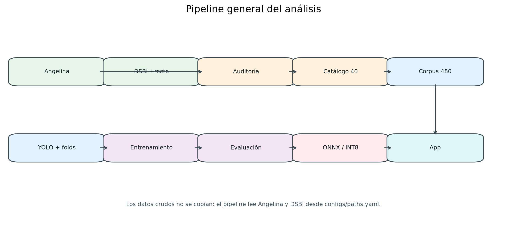

*Figura 1. Pipeline general: fuentes, auditoría, catálogo, corpus, YOLO, folds,
entrenamiento, evaluación y App.*

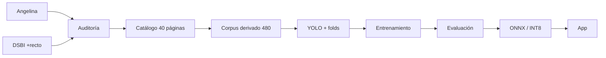

*Diagrama 1. Misma secuencia en Mermaid.*

### 6.2 Diagrama por imagen

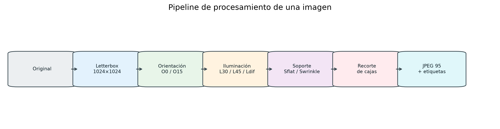

*Figura 2. Secuencia aplicada a cada imagen.*

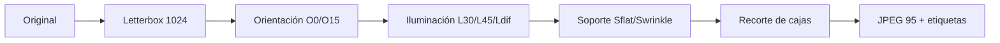

*Diagrama 2. Pipeline de una imagen.*

### 6.3 Lectura y decodificación de fuentes

#### Angelina

- Cada imagen `.jpg` tiene un `.csv` con filas:
  `left;top;right;bottom;label`.
- Las coordenadas están normalizadas en `[0, 1]`.
- Se convierten a píxeles multiplicando por ancho y alto.
- `class_id = label - 1` (YOLO usa clases 0–62).
- Los CSV vacíos se excluyen del corpus, pero pueden usarse como negativos.

#### DSBI

Cada TXT `+recto` contiene:

1. Ángulo de inclinación.
2. Posiciones de líneas verticales.
3. Posiciones de líneas horizontales.
4. Celdas: `fila columna d1 d2 d3 d4 d5 d6`.

La caja de cada celda se obtiene de la rejilla:

- `x1 = verts[col * 2]`
- `x2 = verts[col * 2 + 1]`
- `y1 = horizs[row * 3]`
- `y2 = horizs[row * 3 + 2]`

Los seis puntos se convierten a entero:

```text
int_label = d1*1 + d2*2 + d3*4 + d4*8 + d5*16 + d6*32
class_id = int_label - 1
```

Las celdas vacías (`int_label = 0`) se descartan.

### 6.4 Normalización geométrica: letterbox

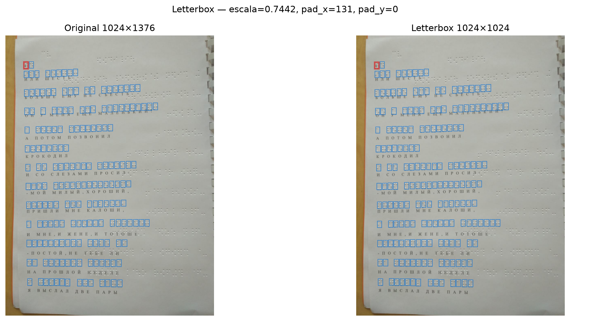

*Figura 3. Imagen original con cajas y resultado del letterbox 1024×1024.*

- Escala uniforme: `scale = min(1024/W, 1024/H)`.
- Redimensionado con **interpolación bilineal** (`PIL.Image.BILINEAR`).
- Lienzo blanco de 1024×1024; relleno centrado:
  `pad_x = (1024 - new_width) // 2`, `pad_y = (1024 - new_height) // 2`.
- Cajas: `x' = x·scale + pad_x`, `y' = y·scale + pad_y`.
- Resultado: todas las imágenes del corpus son 1024×1024.
- El entrenamiento puede redimensionar a `imgsz=640`.

### 6.5 Orientación O15

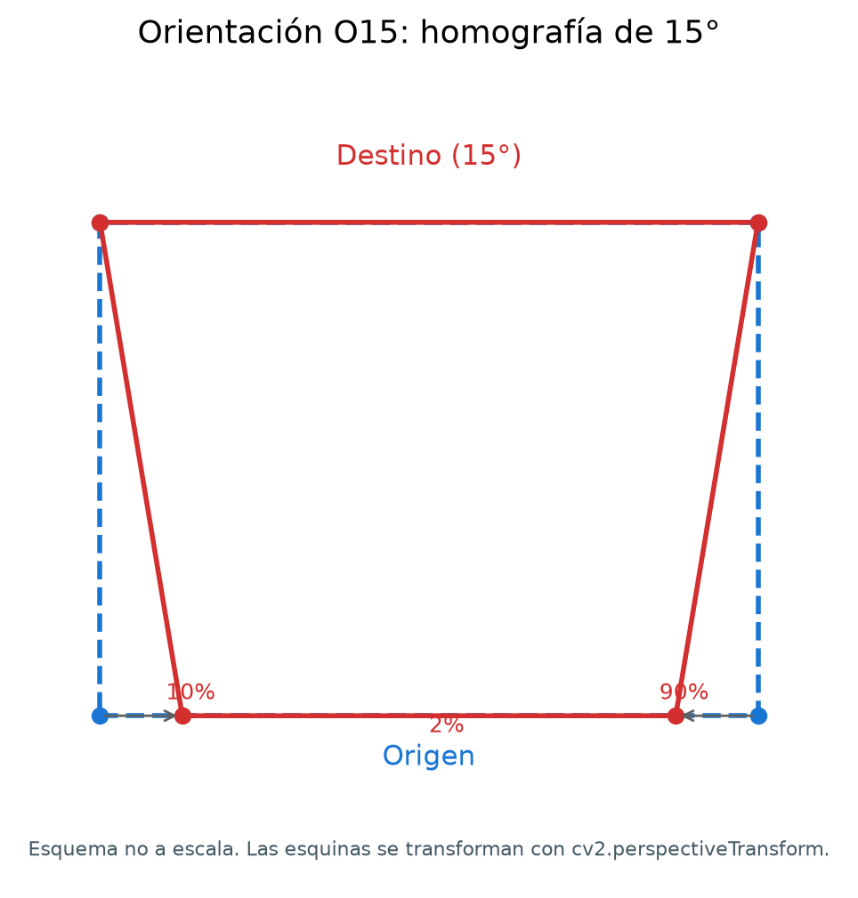

*Figura 4. Rectángulo origen y trapecio destino de la homografía.*

- `O0`: sin transformación.
- `O15`: homografía con `cv2.getPerspectiveTransform`.
- Esquinas superiores del destino: 10 % y 90 % del ancho, 2 % de la altura.
- Esquinas inferiores: sin cambio.
- `cv2.warpPerspective` con **interpolación bilineal**
  (`cv2.INTER_LINEAR`) y borde blanco.
- Cajas: se transforman las 4 esquinas con `cv2.perspectiveTransform`, se toma
  la caja envolvente y se recorta a 1024×1024.

### 6.6 Iluminación

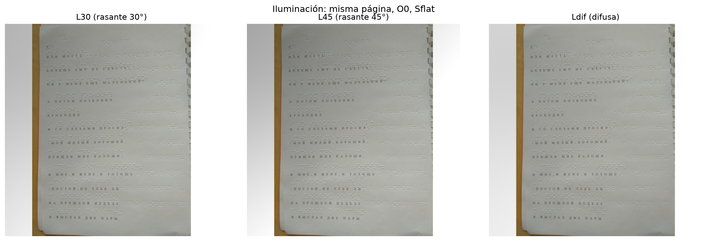

*Figura 5. L30, L45 y Ldif sobre la misma página (O0, Sflat).*

- Gradiente normalizado: `g(x,y) = x·cosθ + y·sinθ`, luego `[0, 1]`.
- `L30`: θ = 30°, factor `0.78 + 0.38·g`.
- `L45`: θ = 45°, factor `0.72 + 0.50·g`.
- `Ldif`: θ = 10°, factor `0.92 + 0.12·g`.
- Sombra gaussiana:
  `s = 1 - 0.12·exp(-d²/(2σ²))`, centro `(0.18W, 0.18H)`,
  `σ = 0.35·max(W,H)`.
- Ruido gaussiano: media 0, desviación 1.5; recorte a `[0, 255]`.
- Solo en `Ldif`: **kernel gaussiano 3×3** con
  `cv2.GaussianBlur(..., (3, 3), 0)`.
- Las cajas no cambian en esta etapa.

### 6.7 Soporte y arrugas

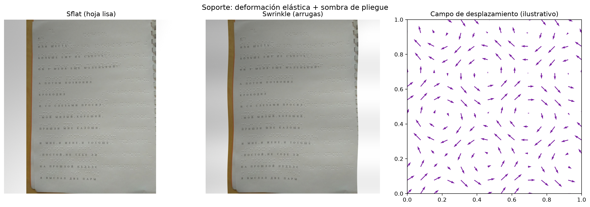

*Figura 6. Sflat vs. Swrinkle y campo de desplazamiento ilustrativo.*

- `Sflat`: sin cambios.
- `Swrinkle`:
  - Amplitud `A = 3.5 px`; fase aleatoria `φ ∈ [0, 2π)`.
  - `dx = A·sin(4π·y/H + φ)`, `dy = A·sin(4π·x/W + φ)`.
  - `cv2.remap` con **interpolación bilineal** (`cv2.INTER_LINEAR`) y borde
    replicado.
  - Sombra de pliegue: `c = 1 - 0.07·(0.5 + 0.5·sin(6π·y/H + φ))`.
  - Cajas: se aplican las mismas fórmulas a las 4 esquinas, se toma la
    envolvente y se recorta.
- **Semilla:** `42 + page_index * 100 + condition_index`.

### 6.8 Transformación de cajas

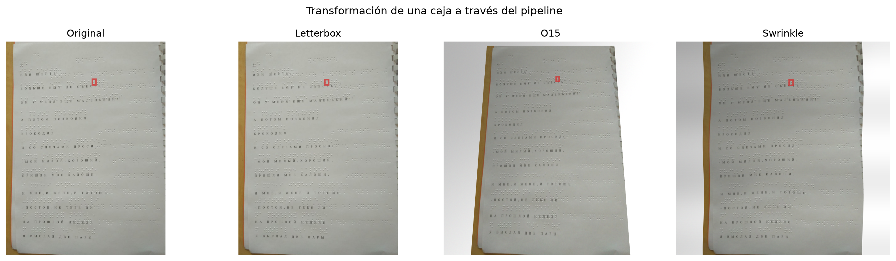

*Figura 7. Una misma caja a través de original, letterbox, O15 y Swrinkle.*

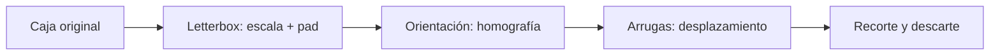

*Diagrama 5. Transformación de una caja.*

- Letterbox: escala + desplazamiento.
- Orientación: homografía a las 4 esquinas.
- Arrugas: desplazamiento elástico a las 4 esquinas.
- Recorte a `[0, 1024]`.
- Se descarta la caja si ancho o alto < 1 px.

### 6.9 Etiquetas y guardado

Para cada imagen se generan:

- `labels/`: YOLO normalizado
  `class_id x_center y_center width height`, 6 decimales.
- `labels_px/`: `class_id x1 y1 x2 y2`, 2 decimales.
- Imagen RGB 1024×1024 en JPEG, calidad 95.
- `metadata.csv`: página, fuente, condición, fold, semilla y número de cajas.

### 6.10 Tabla de kernels y operaciones

| Etapa | Operación | Kernel / interpolación | Parámetros |
|---|---|---|---|
| Letterbox | Redimensionado | Bilineal (`PIL.Image.BILINEAR`) | Escala uniforme |
| Orientación | Homografía | Bilineal (`cv2.INTER_LINEAR`) | Borde blanco |
| Arrugas | Remap elástico | Bilineal (`cv2.INTER_LINEAR`) | Borde replicado |
| Iluminación difusa | Desenfoque | **Gaussiano 3×3** | `sigma = 0` |
| Iluminación | Ruido | Gaussiano por píxel | `μ = 0`, `σ = 1.5` |
| Morfología | No aplicada | — | — |
| Convolución CNN | No aplicada en preprocessing | — | Se aprende en entrenamiento |

### 6.11 Lo que no se aplicó

- No CLAHE.
- No ecualización de histograma.
- No denoising.
- No sharpening.
- No normalización de color.
- No kernels morfológicos.
- No kernels convolucionales manuales; los filtros de la CNN se aprenden en el
  entrenamiento.

### 6.12 Las 12 condiciones

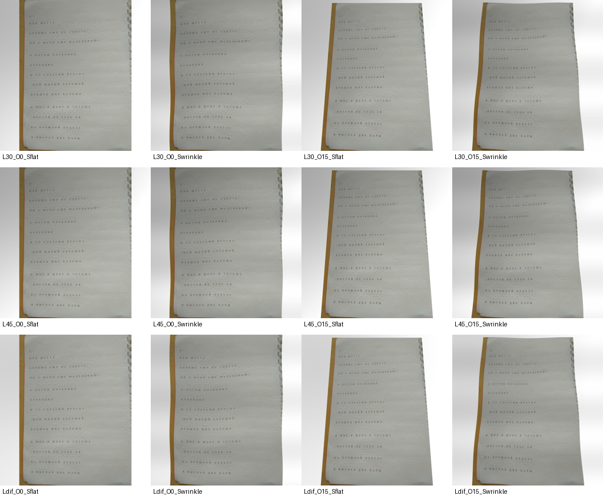

*Figura 10. Rejilla de las 12 condiciones de una misma página.*

| ID | Iluminación | Orientación | Soporte |
|---|---|---|---|
| `L30_O0_Sflat` | rasante 30° | 0° | lisa |
| `L30_O0_Swrinkle` | rasante 30° | 0° | arrugas |
| `L30_O15_Sflat` | rasante 30° | 15° | lisa |
| `L30_O15_Swrinkle` | rasante 30° | 15° | arrugas |
| `L45_O0_Sflat` | rasante 45° | 0° | lisa |
| `L45_O0_Swrinkle` | rasante 45° | 0° | arrugas |
| `L45_O15_Sflat` | rasante 45° | 15° | lisa |
| `L45_O15_Swrinkle` | rasante 45° | 15° | arrugas |
| `Ldif_O0_Sflat` | difusa | 0° | lisa |
| `Ldif_O0_Swrinkle` | difusa | 0° | arrugas |
| `Ldif_O15_Sflat` | difusa | 15° | lisa |
| `Ldif_O15_Swrinkle` | difusa | 15° | arrugas |

---

## 7. Resultados del corpus derivado

### 7.1 Composición

| Fuente | Páginas |
|---|---:|
| Angelina books | 20 |
| Angelina uploaded | 5 |
| DSBI `+recto` | 10 |
| Angelina handwritten | 5 |
| **Total** | **40** |

### 7.2 Corpus

| Métrica | Valor |
|---|---:|
| Imágenes | 480 |
| Páginas | 40 |
| Condiciones por página | 12 |
| Cajas | 141,444 |
| Cajas por imagen | 32–598 |
| Promedio de cajas | 294.7 |
| Clases | 63 |
| Tamaño | 81.9 MB |

### 7.3 Folds

| Fold | Páginas test | Imágenes test | Train | Val | Test | Externo |
|---|---:|---:|---:|---:|---:|---:|
| 0 | 7 | 84 | 24 | 4 | 7 | 5 |
| 1 | 7 | 84 | 24 | 4 | 7 | 5 |
| 2 | 7 | 84 | 24 | 4 | 7 | 5 |
| 3 | 7 | 84 | 24 | 4 | 7 | 5 |
| 4 | 7 | 84 | 24 | 4 | 7 | 5 |

Las 5 páginas manuscritas son prueba externa en todos los folds. Las 12
condiciones de una página permanecen en la misma partición.

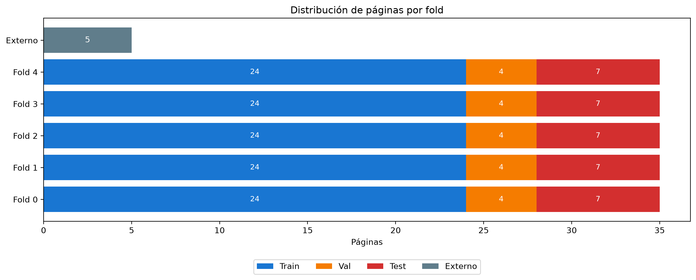

*Figura 8. Distribución de páginas por fold: 24 train, 4 val, 7 test y 5
externas.*

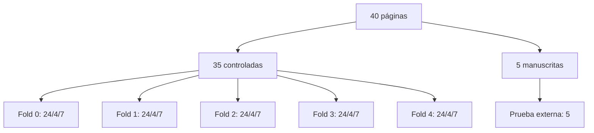

*Diagrama 3. Organización de los folds.*

---

## 8. Validación y evidencia

### 8.1 Validación automática

`reports/validacion_derived_480.json`:

- 480 imágenes.
- 40 páginas.
- 12 condiciones por página.
- 63 clases.
- 0 etiquetas inválidas.
- 0 imágenes con tamaño distinto de 1024×1024.
- Folds 24/4/7 + 5 externas.
- `"ok": true`.

### 8.2 Catálogo

`reports/page_catalog_summary.json`:

- 40 páginas.
- 35 controladas + 5 espontáneas.
- 63/63 clases.
- Folds 7/7/7/7/7.

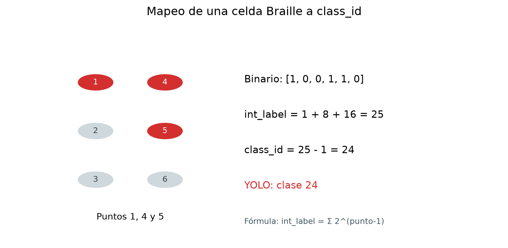

*Figura 9. Ejemplo de mapeo de una celda Braille a `class_id`.*

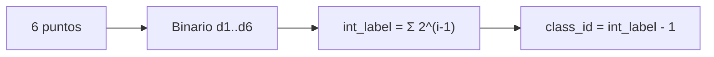

*Diagrama 4. Mapeo canónico de clases.*

### 8.3 Pruebas

```text
13 passed
```

Pruebas incluidas:

- Mapeo de clases.
- Letterbox y 12 condiciones.
- Métricas y encuestas.
- Conteos de folds.
- Conteos del corpus derivado.

### 8.4 Rejilla visual

`reports/figuras/condiciones_12.png` muestra las 12 condiciones de una misma
página para inspección cualitativa.

---

## 9. Estructura entregada

```text
06_Codigo_Analisis/
├── README.md
├── PLAN_ACCION_CORPUS_DERIVADO.md
├── INFORME_AVANCE_2026-11-13.md
├── requirements.txt
├── environment.yml
├── Makefile
├── configs/
├── data/
│   ├── raw/                  # punteros a Angelina y DSBI
│   ├── interim/pages/        # cajas por página
│   ├── processed/derived_480/
│   │   ├── images/           # 480 imágenes
│   │   ├── labels/           # YOLO
│   │   ├── labels_px/        # píxeles
│   │   └── metadata.csv
│   ├── processed/yolo_derived/
│   │   ├── images/all/
│   │   ├── labels/all/
│   │   └── folds/fold_k/data.yaml
│   └── splits/
│       ├── page_catalog.csv
│       ├── derived_folds.csv
│       └── fold_k/
├── src/
│   ├── data/
│   ├── training/
│   ├── evaluation/
│   ├── decoding/
│   ├── statistics/
│   ├── deployment/
│   └── utils/
├── scripts/                  # 10_* a 16_*
├── tests/
├── outputs/
├── docs/
│   ├── DATOS.md
│   ├── PROTOCOLO_CORPUS.md
│   ├── METODOLOGIA.md
│   ├── REPRODUCIBILIDAD.md
│   └── APP.md
└── reports/
    ├── auditoria_fuentes.json
    ├── page_catalog_summary.json
    ├── validacion_derived_480.json
    └── figuras/condiciones_12.png
```

---

## 10. Correspondencia con los objetivos

| Objetivo | Implementación | Estado |
|---|---|---|
| OE1: precisión y robustez | `evaluate.py`, `metrics.py`, `robustness.py` | Wrappers listos; falta entrenar |
| OE2: efecto de INT8 | `export_onnx.py`, `quantize_int8.py`, `benchmark.py` | Exportación y cuantización dinámica listas; estática pendiente |
| OE3: oportunidad, NASA-TLX y SUS | `statistics/tests.py`, `statistics/surveys.py` | Funciones listas; faltan datos de campo |
| Reproducibilidad | `configs/`, `seed.py`, `requirements.txt`, `Makefile` | Implementada |
| App | `deployment/infer.py`, `android_contract.md` | Contrato y base listos; empaquetado pendiente |

---

## 11. Decisiones técnicas

- **Python 3.11** por compatibilidad con Ultralytics, OpenCV y ONNX Runtime.
- **OpenCV + Pillow** para transformaciones geométricas y fotométricas.
- **Ultralytics** para entrenamiento, validación y exportación.
- **ONNX Runtime** para inferencia y benchmark.
- **scikit-learn + SciPy** para métricas y pruebas estadísticas.
- **63 clases** porque son todas las combinaciones no vacías de 6 puntos.
- **Solo `+recto`** porque el proyecto es de una sola cara.
- **1024×1024** para uniformizar fuentes; **640** para entrenamiento móvil.
- **5 folds 24/4/7** para reproducir la Tabla 2 del proyecto.
- **Corpus derivado** para no depender de datos de campo en esta etapa.

---

## 12. Limitaciones y riesgos

| Limitación | Impacto | Mitigación |
|---|---|---|
| Corpus derivado, no de campo | Menor validez ecológica | Declararlo; aprobación del asesor |
| Fuentes multilingües | Evaluación no española | El detector es agnóstico a nivel de celda; agregar fuente española si se consigue |
| Manuscritas sin errores garantizados | No replica “producción espontánea con errores” | Documentarlo; buscar páginas con tachaduras |
| Desbalance de clases | Clases raras con pocas muestras | Reportar distribución; augmentation y class weights |
| Arrugas simuladas | Puede no capturar toda la variabilidad real | Deformación conservadora + validación visual |
| INT8 estático pendiente | H2 aún no evaluable | Implementar calibración con split de validación |
| Mapa español incompleto | La App no decodifica acentos/signos | Completar tabla española Grado 1 |

---

## 13. Pendientes y próximos pasos

1. **Aprobación del asesor** sobre el corpus derivado.
2. **Entrenar** las 4 configuraciones × 5 folds:
   - YOLOv8n FP32.
   - YOLOv8n INT8.
   - YOLOv11 FP32.
   - YOLOv11 INT8.
3. **Evaluar** mAP, F1, Kappa, AUC-ROC, CER/WER y latencia.
4. **Cuantización INT8 estática** con calibración.
5. **Completar** el mapa español de acentos, números y signos.
6. **Empaquetar** la App Android.
7. **Comparar** los resultados del corpus derivado con la literatura.

---

## 14. Preguntas frecuentes para el asesor

**¿Por qué no se usaron las 40 páginas de campo?**
Porque no están disponibles en el repositorio. Se usó un corpus derivado de
Angelina y DSBI para no detener el desarrollo. El corpus de campo sigue siendo
el ideal.

**¿El corpus derivado es válido?**
Sí para desarrollar y comparar el pipeline. No reemplaza la evidencia ecológica.
Debe declararse como derivado.

**¿Por qué solo `+recto`?**
El proyecto es de una sola cara; `+verso` tiene un patrón visual inverso y
duplicados.

**¿Por qué 63 clases?**
Son todas las combinaciones no vacías de 6 puntos; el detector es independiente
del idioma.

**¿Por qué 24/4/7?**
Reproduce la Tabla 2 del proyecto: 24 páginas de entrenamiento, 4 de validación y
7 de prueba por fold, más 5 externas.

**¿Qué falta para la tesis?**
Aprobación del corpus, entrenamiento, evaluación, cuantización estática y
validación con el asesor.

---

## 15. Anexos

### A. Registro de comandos

```bash
python scripts/10_audit_sources.py
python scripts/11_build_page_catalog.py
python scripts/12_build_derived_480.py --overwrite
python scripts/13_validate_derived_480.py
python scripts/14_convert_yolo.py
python scripts/15_build_folds.py
python scripts/16_make_condition_grid.py
python scripts/17_make_pipeline_figures.py
python -m pytest -q
```

### B. Mapeo de clases

Fórmula:

```text
int_label = sum(2 ** (dot - 1) for each raised dot)
class_id = int_label - 1
```

Ejemplos:

| Puntos | int_label | class_id |
|---|---:|---:|
| 1 | 1 | 0 |
| 12 | 3 | 2 |
| 14 | 9 | 8 |
| 145 | 25 | 24 |
| 123456 | 63 | 62 |

El mapeo completo está en `src/data/class_mapping.py`.

### C. Condiciones

Las 12 condiciones se listan en la sección 6.4 y en
`src/data/photometric.py`.

### D. Inventario de archivos

| Archivo | Rol |
|---|---|
| `data/splits/page_catalog.csv` | 40 páginas seleccionadas |
| `data/processed/derived_480/metadata.csv` | 480 filas con condición y fold |
| `data/splits/derived_folds.csv` | Asignación página/fold/split |
| `data/processed/yolo_derived/folds/fold_k/data.yaml` | Configuración YOLO por fold |
| `reports/auditoria_fuentes.json` | Auditoría de fuentes |
| `reports/page_catalog_summary.json` | Cobertura y folds |
| `reports/validacion_derived_480.json` | Validación final |
| `reports/figuras/condiciones_12.png` | Rejilla visual |

### E. Glosario

- **YOLO:** detector de objetos de una etapa.
- **Letterbox:** redimensionar con relleno para conservar la relación de aspecto.
- **NMS:** supresión de cajas no máximas.
- **mAP:** precisión media promedio.
- **INT8:** cuantización a enteros de 8 bits.
- **Fold:** partición de validación cruzada.
- **Clase Braille:** patrón de 6 puntos, `1..63`.
- **Recto:** cara frontal con puntos convexos.
- **Verso:** cara posterior con hendiduras.

### F. Referencias

- Ovodov, I. G. (2021). *Optical Braille Recognition Using Object Detection
  Neural Network*. ICCVW.
- Li, R., Liu, H., Wan, X., & Qian, Y. (2018). *DSBI: Double-Sided Braille Image
  Dataset and Algorithm Evaluation for Braille Dots Detection*. arXiv:1811.10893.
- Ultralytics. *YOLO Documentation*. https://docs.ultralytics.com
- OpenCV. *OpenCV Documentation*. https://docs.opencv.org
- ONNX Runtime. *Documentation*. https://onnxruntime.ai

---

*Informe generado para documentar el avance del análisis de datos. Actualizar al
cierre de cada sesión.*
