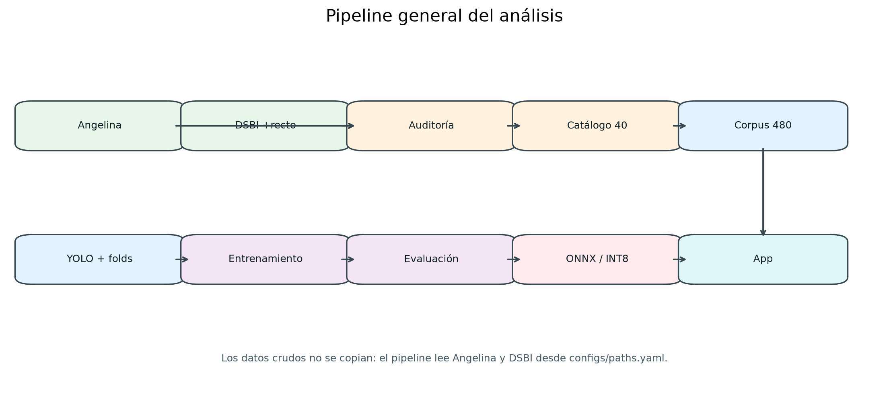
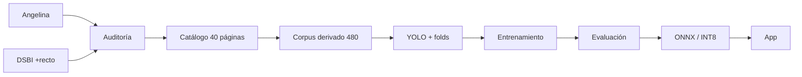
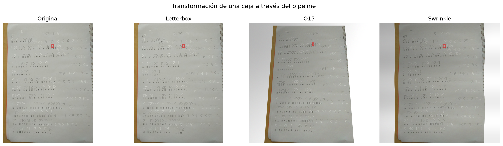
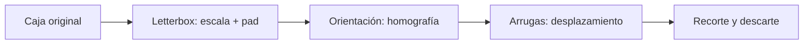
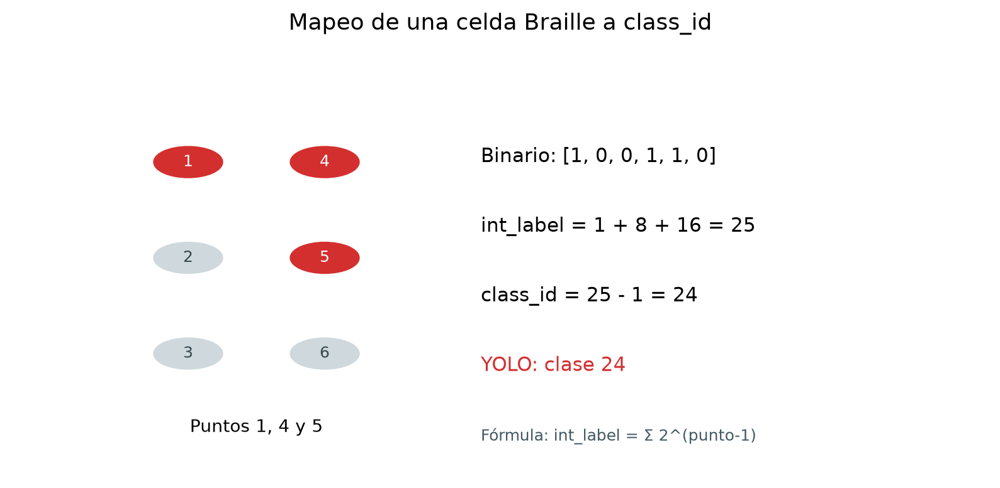
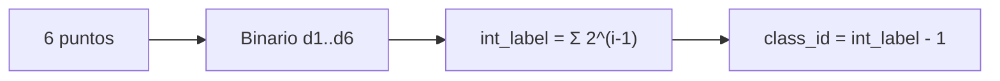

# Metodología y trazabilidad

## Objetivos

| Objetivo | Implementación |
|---|---|
| OE1: precisión y robustez | `src/evaluation/metrics.py`, `src/evaluation/evaluate.py`, `src/evaluation/robustness.py` |
| OE2: efecto de INT8 | `src/training/export_onnx.py`, `src/training/quantize_int8.py`, `src/evaluation/benchmark.py` |
| OE3: oportunidad, NASA-TLX y SUS | `src/statistics/tests.py`, `src/statistics/surveys.py` |
| Reproducibilidad | `configs/`, `src/utils/seed.py`, `requirements.txt`, `docs/REPRODUCIBILIDAD.md` |

## Flujo

1. **Auditoría:** `scripts/10_audit_sources.py`.
2. **Catálogo:** `scripts/11_build_page_catalog.py`.
3. **Corpus derivado:** `scripts/12_build_derived_480.py`.
4. **Validación:** `scripts/13_validate_derived_480.py`.
5. **YOLO:** `scripts/14_convert_yolo.py`.
6. **Folds:** `scripts/15_build_folds.py`.
7. **Entrenamiento:** `python -m src.training.train --config configs/...`.
8. **Evaluación:** `python -m src.evaluation.evaluate ...`.
9. **Cuantización:** `python -m src.training.quantize_int8 ...`.
10. **Estadística:** `src/statistics/tests.py` y `surveys.py`.

## Diagramas

*Figura 1. Pipeline general del análisis.*

*Figura 7. Transformación de una caja a través del pipeline.*

*Figura 9. Mapeo de una celda Braille a `class_id`.*

## Métricas

- mAP@0.5 y mAP@0.5:0.95 (Ultralytics).
- F1 macro, Kappa de Cohen, AUC-ROC macro OVR (`sklearn`).
- CER/WER con distancia de Levenshtein.
- Latencia, tamaño y memoria (`benchmark.py`).
- Wilcoxon, McNemar, bootstrap, tamaño del efecto.
- NASA-TLX y SUS.

## Clases

- 63 patrones de puntos; `int_label = 1..63`; `class_id = int_label - 1`.
- `src/data/class_mapping.py` es la fuente única.
- `src/decoding/braille_map.py` contiene el mapa español Grado 1 parcial.

## Decodificación

`src/evaluation/reading_order.py` agrupa detecciones por línea y
`src/decoding/decode.py` convierte los `class_id` en texto.

## Limitaciones

- El corpus derivado no es de campo.
- El mapa español de acentos y signos específicos está incompleto (`TODO`).
- La cuantización INT8 estática con calibración está pendiente (`TODO`).
