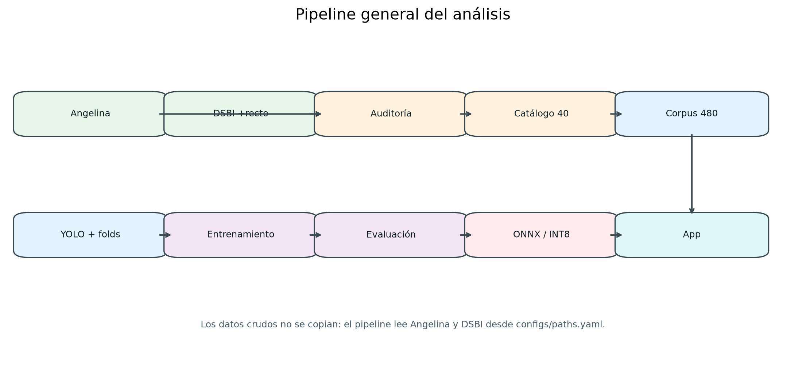
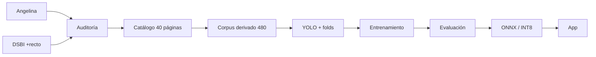
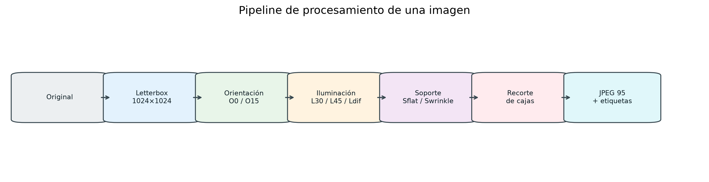
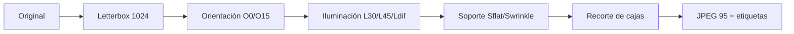
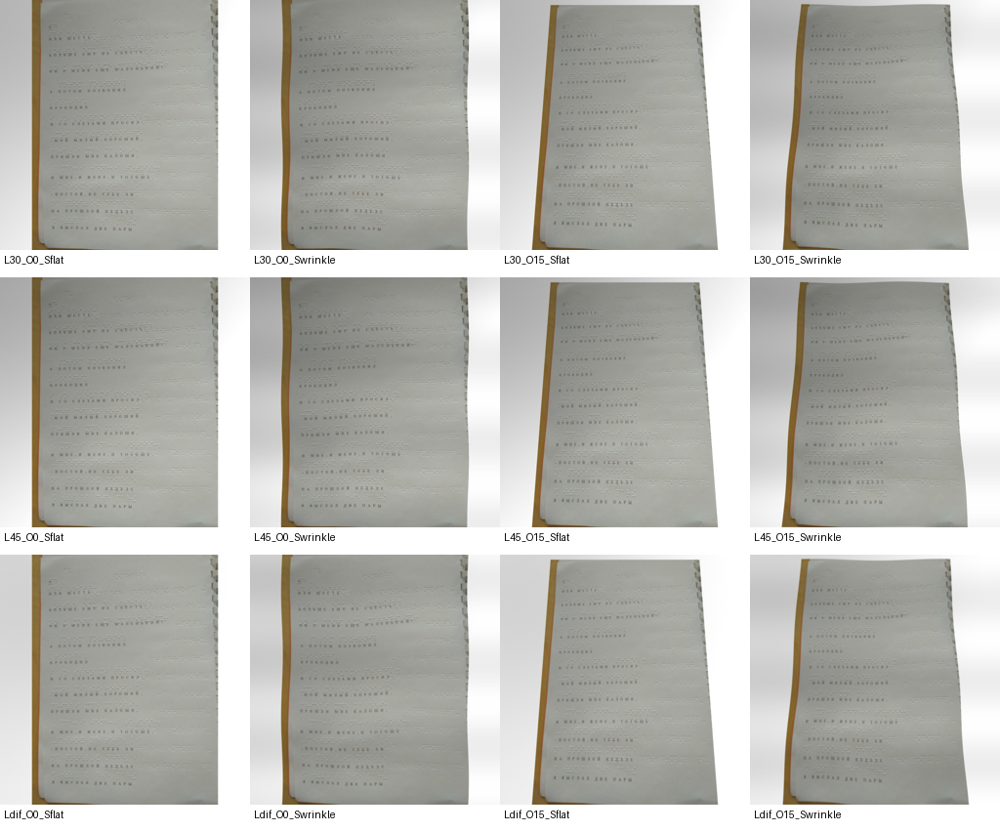

# Protocolo del corpus derivado 40 × 12

## Objetivo

Reproducir el diseño de 40 páginas × 12 condiciones fotométricas = 480 imágenes
usando solo Angelina y DSBI `+recto`, sin recolectar imágenes de campo.

El corpus se declara **derivado**. No sustituye a un corpus de campo y requiere
aprobación del asesor.

## Selección de páginas

| Fuente | Páginas | Criterio |
|---|---:|---|
| Angelina books | 20 | Cobertura de clases y variedad |
| Angelina uploaded | 5 | Fotos reales de usuario |
| DSBI recto | 10 | Cobertura de clases raras; incluye clase 41 |
| Angelina handwritten | 5 | Aproximación a producción espontánea |
| **Total** | **40** | |

- La selección es determinista con `seed=42`.
- Se verifica que las 40 páginas cubran las 63 clases.
- Las 5 manuscritas no garantizan errores ortográficos reales; se documentará
  como limitación.

## Condiciones

| Factor | Niveles |
|---|---|
| Iluminación | `L30`, `L45`, `Ldif` |
| Orientación | `O0`, `O15` |
| Soporte | `Sflat`, `Swrinkle` |

Cada combinación produce un `condition_id`, por ejemplo `L30_O15_Swrinkle`.

### Implementación

- **Letterbox** a 1024×1024 con relleno blanco; las cajas se escalan y desplazan.
- **Orientación:** homografía de 15°; las cuatro esquinas de cada caja se
  transforman y se toma la caja envolvente.
- **Iluminación:** gradiente direccional + sombra gaussiana; no mueve cajas.
- **Arrugas:** deformación elástica suave + sombras de pliegue; las esquinas de
  las cajas se transforman con el mismo campo de desplazamiento.
- **Semilla:** `seed + page_index * 100 + condition_index`.

### Diagramas

*Figura 1. Pipeline general: fuentes, catálogo, corpus, YOLO y folds.*

*Figura 2. Procesamiento aplicado a cada imagen.*

*Figura 10. Rejilla de las 12 condiciones.*

### Kernels y operaciones

| Etapa | Operación | Kernel / interpolación | Parámetros |
|---|---|---|---|
| Letterbox | Redimensionado | Bilineal (`PIL.Image.BILINEAR`) | Escala uniforme |
| Orientación | Homografía | Bilineal (`cv2.INTER_LINEAR`) | Borde blanco |
| Arrugas | Remap elástico | Bilineal (`cv2.INTER_LINEAR`) | Borde replicado |
| Iluminación difusa | Desenfoque | **Gaussiano 3×3** | `sigma = 0` |
| Iluminación | Ruido | Gaussiano por píxel | `μ = 0`, `σ = 1.5` |
| Morfología | No aplicada | — | — |
| Convolución CNN | No aplicada en preprocessing | — | Se aprende en entrenamiento |

### Lo que no se aplicó

- No CLAHE.
- No ecualización de histograma.
- No denoising.
- No sharpening.
- No normalización de color.
- No kernels morfológicos.
- No kernels convolucionales manuales.

## Folds

- 35 páginas controladas → 5 folds de 7.
- En cada experimento: 24 train, 4 val, 7 test.
- 5 manuscritas → prueba externa.
- Las 12 condiciones de una página permanecen en la misma partición.

## Validación

`python scripts/13_validate_derived_480.py` comprueba:

- 480 imágenes.
- 40 `page_id`.
- 12 condiciones por página.
- 63 clases.
- Etiquetas en `[0, 1]` y cajas válidas.
- Imágenes de 1024×1024.
- Folds 24/4/7/5 sin páginas repetidas.

## Limitaciones

- Corpus derivado, no de campo.
- Fuentes multilingües (ruso/inglés/chino).
- Sin páginas reales de Moquegua/Ilo.
- Las 5 manuscritas no garantizan errores reales.
- Requiere aprobación del asesor.

## Fallback

Si el asesor no aprueba el corpus derivado:

1. Recolectar las 40 páginas en campo.
2. O cambiar a un corpus multi-fuente real, con splits por fuente/página.
