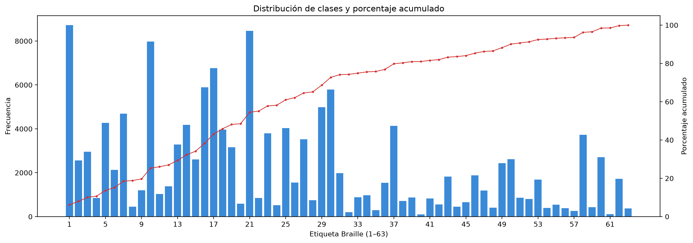
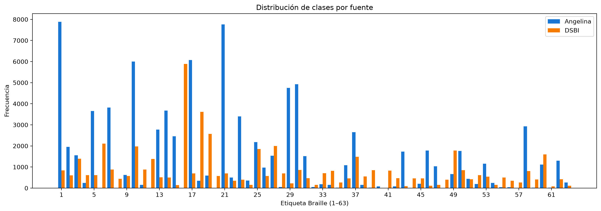
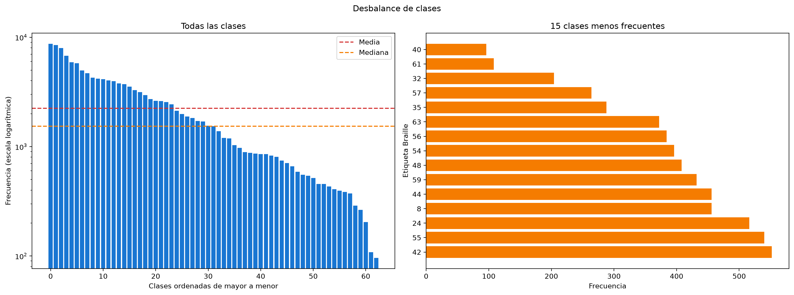
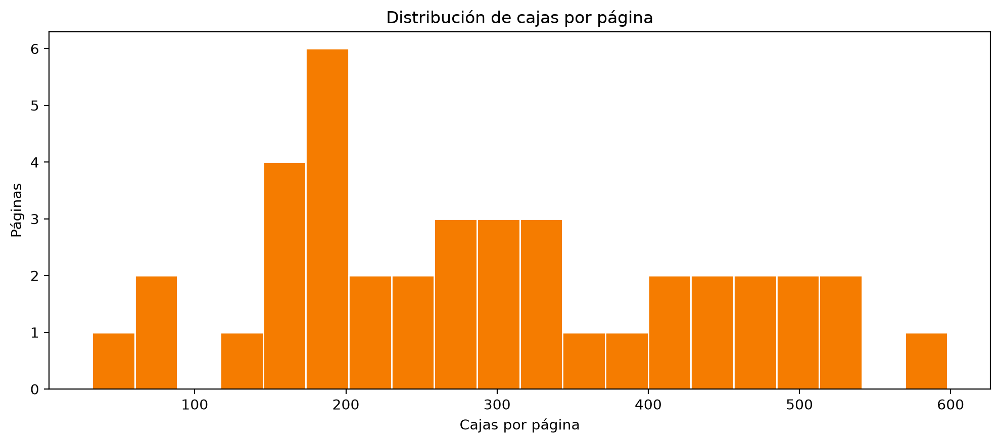
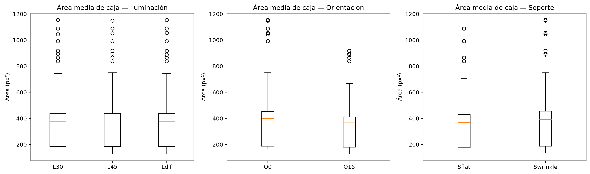
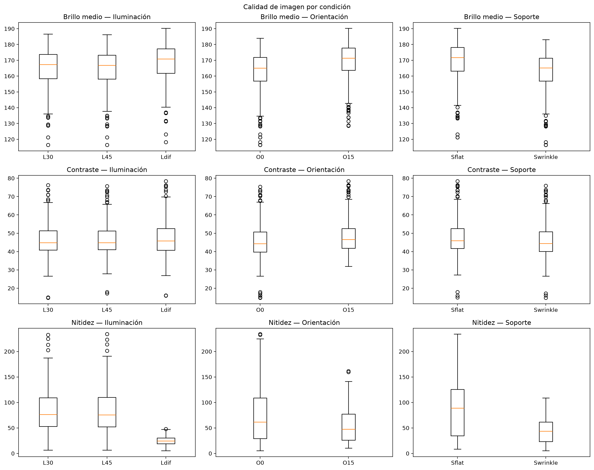
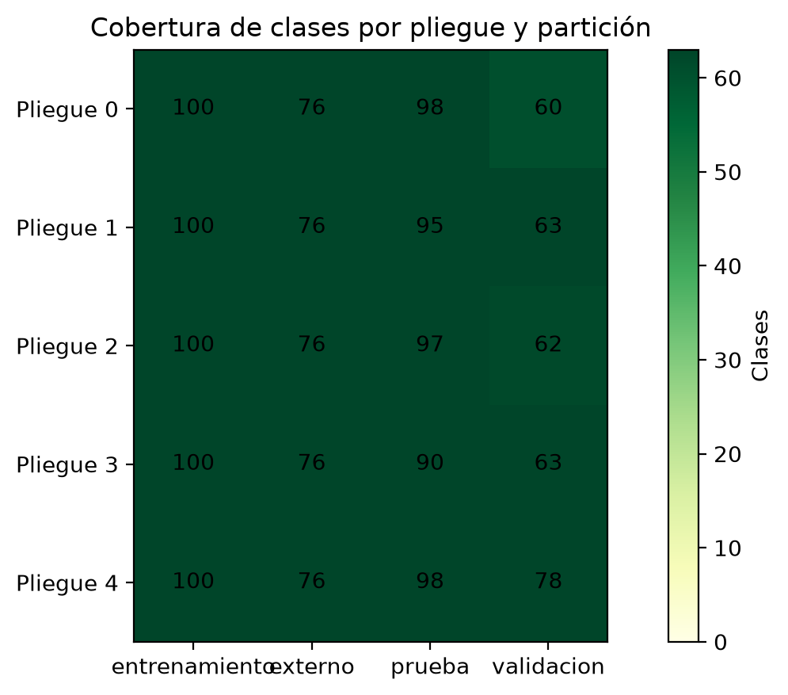

# Reporte detallado del análisis de datos

Este reporte describe el corpus derivado de 40 páginas × 12 condiciones. No incluye entrenamiento de modelos; se centra en la calidad, composición, balance y cobertura de los datos.

## 1. Resumen del corpus

| Métrica | Valor |
| --- | --- |
| imagenes | 480 |
| paginas | 40 |
| condiciones | 12 |
| cajas | 141444 |
| clases | 63 |
| cajas_por_pagina_media | 294.675 |
| cajas_por_pagina_mediana | 276 |
| cajas_por_pagina_desviacion | 141.890 |
| cajas_por_pagina_min | 32 |
| cajas_por_pagina_max | 598 |
| cajas_por_imagen_media | 294.675 |
| cajas_por_imagen_desviacion | 140.251 |
| area_caja_media_px2 | 370.249 |
| area_caja_mediana_px2 | 379.200 |
| brillo_medio | 165.618 |
| contraste_medio | 47.121 |
| nitidez_media | 65.572 |

## 2. Composición por fuente y subconjunto

| fuente | paginas | imagenes | cajas | clases | cajas_por_pagina |
| --- | --- | --- | --- | --- | --- |
| angelina | 30 | 360 | 89208 | 58 | 247.800 |
| dsbi | 10 | 120 | 52236 | 63 | 435.300 |

| subconjunto | paginas | imagenes | cajas | clases | cajas_por_pagina |
| --- | --- | --- | --- | --- | --- |
| libros | 20 | 240 | 60840 | 46 | 253.500 |
| manuscritas | 5 | 60 | 8100 | 48 | 135 |
| recto | 10 | 120 | 52236 | 63 | 435.300 |
| subidas | 5 | 60 | 20268 | 54 | 337.800 |

## 3. Distribución de clases

| identificador_clase | etiqueta_braille | puntos | frecuencia | porcentaje | frecuencia_angelina | frecuencia_dsbi |
| --- | --- | --- | --- | --- | --- | --- |
| 0 | 1 | 1 | 8724 | 6.168 | 7884 | 840 |
| 1 | 2 | 2 | 2556 | 1.807 | 1956 | 600 |
| 2 | 3 | 12 | 2952 | 2.087 | 1560 | 1392 |
| 3 | 4 | 3 | 852 | 0.602 | 240 | 612 |
| 4 | 5 | 13 | 4272 | 3.020 | 3660 | 612 |
| 5 | 6 | 23 | 2124 | 1.502 | 12 | 2112 |
| 6 | 7 | 123 | 4692 | 3.317 | 3816 | 876 |
| 7 | 8 | 4 | 456 | 0.322 | 12 | 444 |
| 8 | 9 | 14 | 1200 | 0.848 | 624 | 576 |
| 9 | 10 | 24 | 7980 | 5.642 | 6000 | 1980 |
| 10 | 11 | 124 | 1032 | 0.730 | 156 | 876 |
| 11 | 12 | 34 | 1380 | 0.976 | 0 | 1380 |
| 12 | 13 | 134 | 3288 | 2.325 | 2772 | 516 |
| 13 | 14 | 234 | 4176 | 2.952 | 3672 | 504 |
| 14 | 15 | 1234 | 2604 | 1.841 | 2460 | 144 |
| 15 | 16 | 5 | 5892 | 4.166 | 0 | 5892 |
| 16 | 17 | 15 | 6768 | 4.785 | 6072 | 696 |
| 17 | 18 | 25 | 3960 | 2.800 | 348 | 3612 |
| 18 | 19 | 125 | 3156 | 2.231 | 588 | 2568 |
| 19 | 20 | 35 | 588 | 0.416 | 12 | 576 |

**15 clases más frecuentes:**

| etiqueta_braille | puntos | frecuencia | porcentaje | frecuencia_angelina | frecuencia_dsbi |
| --- | --- | --- | --- | --- | --- |
| 1 | 1 | 8724 | 6.168 | 7884 | 840 |
| 21 | 135 | 8460 | 5.981 | 7764 | 696 |
| 10 | 24 | 7980 | 5.642 | 6000 | 1980 |
| 17 | 15 | 6768 | 4.785 | 6072 | 696 |
| 16 | 5 | 5892 | 4.166 | 0 | 5892 |
| 30 | 2345 | 5784 | 4.089 | 4920 | 864 |
| 29 | 1345 | 4980 | 3.521 | 4752 | 228 |
| 7 | 123 | 4692 | 3.317 | 3816 | 876 |
| 5 | 13 | 4272 | 3.020 | 3660 | 612 |
| 14 | 234 | 4176 | 2.952 | 3672 | 504 |
| 37 | 136 | 4140 | 2.927 | 2652 | 1488 |
| 25 | 145 | 4032 | 2.851 | 2184 | 1848 |
| 18 | 25 | 3960 | 2.800 | 348 | 3612 |
| 23 | 1235 | 3792 | 2.681 | 3396 | 396 |
| 58 | 2456 | 3732 | 2.639 | 2928 | 804 |

## 4. Desbalance de clases

| Métrica | Valor |
| --- | --- |
| clases_presentes | 63 |
| clases_ausentes | 0 |
| minimo | 96 |
| maximo | 8724 |
| razon_maximo_minimo | 90.875 |
| coeficiente_variacion | 0.947 |
| entropia_normalizada | 0.903 |
| gini_impureza | 0.970 |
| clases_menos_10 | 0 |
| clases_menos_50 | 0 |
| clases_menos_100 | 1 |
| mediana | 1536 |

**15 clases menos frecuentes:**

| etiqueta_braille | puntos | frecuencia | porcentaje | frecuencia_angelina | frecuencia_dsbi |
| --- | --- | --- | --- | --- | --- |
| 40 | 46 | 96 | 0.068 | 84 | 12 |
| 61 | 13456 | 108 | 0.076 | 24 | 84 |
| 32 | 6 | 204 | 0.144 | 48 | 156 |
| 57 | 1456 | 264 | 0.187 | 0 | 264 |
| 35 | 126 | 288 | 0.204 | 24 | 264 |
| 63 | 123456 | 372 | 0.263 | 264 | 108 |
| 56 | 456 | 384 | 0.271 | 36 | 348 |
| 54 | 2356 | 396 | 0.280 | 240 | 156 |
| 48 | 56 | 408 | 0.288 | 12 | 396 |
| 59 | 12456 | 432 | 0.305 | 24 | 408 |
| 44 | 346 | 456 | 0.322 | 0 | 456 |
| 8 | 4 | 456 | 0.322 | 12 | 444 |
| 24 | 45 | 516 | 0.365 | 360 | 156 |
| 55 | 12356 | 540 | 0.382 | 36 | 504 |
| 42 | 246 | 552 | 0.390 | 84 | 468 |

## 5. Cajas por página y por condición

| condicion | imagenes | cajas | brillo_medio | brillo_desviacion | contraste_medio | contraste_desviacion | nitidez_media | nitidez_desviacion | area_caja_media | area_caja_desviacion |
| --- | --- | --- | --- | --- | --- | --- | --- | --- | --- | --- |
| L30_O0_Sflat | 40 | 11787 | 164.499 | 13.369 | 46.101 | 10.476 | 135.883 | 50.982 | 378.813 | 206.258 |
| L30_O0_Swrinkle | 40 | 11787 | 158.229 | 12.912 | 44.587 | 10.061 | 65.054 | 24.035 | 402.012 | 217.690 |
| L30_O15_Sflat | 40 | 11787 | 171.151 | 12.156 | 49.011 | 9.481 | 94.995 | 27.197 | 339.242 | 171.926 |
| L30_O15_Swrinkle | 40 | 11787 | 164.666 | 11.723 | 47.370 | 9.157 | 48.376 | 13.573 | 360.862 | 182.180 |
| L45_O0_Sflat | 40 | 11787 | 164.092 | 13.377 | 46.656 | 9.912 | 135.427 | 51.433 | 378.813 | 206.258 |
| L45_O0_Swrinkle | 40 | 11787 | 157.837 | 12.922 | 45.077 | 9.566 | 64.620 | 23.647 | 402.209 | 218.059 |
| L45_O15_Sflat | 40 | 11787 | 170.515 | 12.211 | 48.891 | 9.169 | 94.448 | 27.275 | 339.242 | 171.926 |
| L45_O15_Swrinkle | 40 | 11787 | 163.993 | 11.781 | 47.250 | 8.818 | 48.146 | 13.522 | 360.846 | 182.498 |
| Ldif_O0_Sflat | 40 | 11787 | 167.819 | 13.573 | 46.652 | 10.960 | 31.604 | 9.536 | 378.813 | 206.258 |
| Ldif_O0_Swrinkle | 40 | 11787 | 161.417 | 13.085 | 45.178 | 10.500 | 21.516 | 6.742 | 402.345 | 218.487 |
| Ldif_O15_Sflat | 40 | 11787 | 174.918 | 12.265 | 50.147 | 9.939 | 27.823 | 6.276 | 339.242 | 171.926 |
| Ldif_O15_Swrinkle | 40 | 11787 | 168.285 | 11.820 | 48.534 | 9.552 | 18.968 | 4.444 | 360.551 | 181.797 |

## 6. Calidad de imagen

## 7. Pruebas estadísticas

| prueba | n | estadistico | p_valor |
| --- | --- | --- | --- |
| brillo_friedman_iluminacion | 160 | 314.113 | 6.185e-69 |
| brillo_wilcoxon_orientacion | 240 | 0 | 4.015e-41 |
| brillo_wilcoxon_soporte | 240 | 0 | 4.015e-41 |
| contraste_friedman_iluminacion | 160 | 78.463 | 9.164e-18 |
| contraste_wilcoxon_orientacion | 240 | 77 | 1.052e-40 |
| contraste_wilcoxon_soporte | 240 | 1 | 4.066e-41 |
| nitidez_friedman_iluminacion | 160 | 260 | 3.481e-57 |
| nitidez_wilcoxon_orientacion | 240 | 1862 | 1.261e-31 |
| nitidez_wilcoxon_soporte | 240 | 0 | 4.015e-41 |
| area_caja_media_friedman_iluminacion | 160 | 1.225 | 5.420e-01 |
| area_caja_media_wilcoxon_orientacion | 240 | 0 | 4.009e-41 |
| area_caja_media_wilcoxon_soporte | 240 | 0 | 4.015e-41 |

**Otras métricas:**

| metrica | valor |
| --- | --- |
| divergencia_jensen_shannon_angelina_dsbi | 0.602 |
| cajas_por_pagina_intervalo_confianza_95 | [251.849375, 338.251875] |
| clases_presentes | 63 |
| clases_ausentes | 0 |
| minimo | 96 |
| maximo | 8724 |
| razon_maximo_minimo | 90.875 |
| coeficiente_variacion | 0.947 |
| entropia_normalizada | 0.903 |
| gini_impureza | 0.970 |
| clases_menos_10 | 0 |
| clases_menos_50 | 0 |
| clases_menos_100 | 1 |
| mediana | 1536 |

## 8. Cobertura por pliegue

| pliegue | particion | paginas | imagenes | cajas | clases | cobertura | clases_faltantes |
| --- | --- | --- | --- | --- | --- | --- | --- |
| 0 | entrenamiento | 24 | 288 | 94656 | 63 | 100 |  |
| 0 | validacion | 4 | 48 | 11340 | 38 | 60.317 | 3,5,7,10,11,15,17,19,23,27,31,32,33,34,38,40,43,47,53,54,55,56,58,60,62 |
| 0 | prueba | 7 | 84 | 27348 | 62 | 98.413 | 31 |
| 0 | externo | 5 | 60 | 8100 | 48 | 76.190 | 5,7,11,15,33,34,38,39,40,41,43,47,54,56,58 |
| 1 | entrenamiento | 24 | 288 | 98604 | 63 | 100 |  |
| 1 | validacion | 4 | 48 | 9324 | 40 | 63.492 | 3,5,7,10,11,15,19,23,31,33,38,39,40,41,43,44,47,53,55,56,58,60,62 |
| 1 | prueba | 7 | 84 | 25416 | 60 | 95.238 | 7,23,34 |
| 1 | externo | 5 | 60 | 8100 | 48 | 76.190 | 5,7,11,15,33,34,38,39,40,41,43,47,54,56,58 |
| 2 | entrenamiento | 24 | 288 | 94056 | 63 | 100 |  |
| 2 | validacion | 4 | 48 | 15084 | 39 | 61.905 | 3,5,7,10,11,15,19,23,27,31,32,34,38,40,41,43,47,53,54,55,56,58,60,62 |
| 2 | prueba | 7 | 84 | 24204 | 61 | 96.825 | 39,60 |
| 2 | externo | 5 | 60 | 8100 | 48 | 76.190 | 5,7,11,15,33,34,38,39,40,41,43,47,54,56,58 |
| 3 | entrenamiento | 24 | 288 | 92556 | 63 | 100 |  |
| 3 | validacion | 4 | 48 | 13020 | 40 | 63.492 | 3,5,7,11,15,19,23,27,31,34,37,38,40,43,44,47,53,54,55,56,58,60,62 |
| 3 | prueba | 7 | 84 | 27768 | 57 | 90.476 | 19,23,41,43,56,58 |
| 3 | externo | 5 | 60 | 8100 | 48 | 76.190 | 5,7,11,15,33,34,38,39,40,41,43,47,54,56,58 |
| 4 | entrenamiento | 24 | 288 | 90552 | 63 | 100 |  |
| 4 | validacion | 4 | 48 | 14184 | 49 | 77.778 | 5,7,11,15,19,31,33,40,43,47,53,56,58,60 |
| 4 | prueba | 7 | 84 | 28608 | 62 | 98.413 | 55 |
| 4 | externo | 5 | 60 | 8100 | 48 | 76.190 | 5,7,11,15,33,34,38,39,40,41,43,47,54,56,58 |

## 9. Integridad y duplicados

- Grupos de imágenes duplicadas: **0**
- Imágenes con tamaño distinto de 1024×1024: **0** (validado en el corpus)
- Clases cubiertas: **63/63**

## 10. Conclusiones del análisis de datos

- El corpus está balanceado por página y condición: 40 imágenes por condición y 12 imágenes por página.
- La distribución de clases es desigual: la clase más frecuente tiene 8724 cajas y la menos frecuente 96.
- DSBI aporta 63/63 clases y Angelina 58/63; la combinación cubre el espacio completo.
- La orientación y el soporte modifican el área de caja; la iluminación no (p≈0.542).
- La cobertura de entrenamiento es 63/63 en todos los pliegues; validación, prueba y externo no cubren todas las clases, algo esperado por su tamaño.
- El desbalance es alto (razón máximo/mínimo ≈ 90.9), por lo que se recomienda aumento de datos y pesos por clase.

## 11. Glosario de términos

| Término | Definición |
| --- | --- |
| OBR | Reconocimiento óptico de Braille: conversión de una imagen de texto en relieve a texto digital. |
| CNN | Red neuronal convolucional: modelo de aprendizaje profundo especializado en imágenes. |
| Braille Grado 1 | Escritura táctil en la que cada carácter se representa por una celda de seis puntos, sin contracciones. |
| Celda Braille | Unidad de 2 columnas por 3 filas que representa un carácter o signo. |
| Punto Braille | Cada uno de los seis relieves posibles dentro de una celda, numerados del 1 al 6. |
| Etiqueta Braille | Número entero de 1 a 63 que codifica los puntos presentes en una celda. |
| Caja delimitadora | Rectángulo que encierra una celda Braille en la imagen. |
| Anotación | Archivo que indica las cajas y la clase de cada celda de una imagen. |
| Corpus derivado | Conjunto de 40 páginas × 12 condiciones generado a partir de Angelina y DSBI. |
| Pliegue | Cada una de las particiones de la validación cruzada. |
| Partición | Conjunto de entrenamiento, validación, prueba o externo. |
| Desbalance de clases | Frecuencias muy distintas entre las clases. |
| Entropía normalizada | Medida entre 0 y 1; más cerca de 1 indica mayor equilibrio. |
| Impureza de Gini | Medida entre 0 y 1; más cerca de 1 indica mayor desbalance. |
| Divergencia de Jensen-Shannon | Medida entre 0 y 1 de la diferencia entre dos distribuciones. |
| Brillo medio | Promedio de los niveles de gris de la imagen. |
| Contraste | Desviación estándar de los niveles de gris. |
| Nitidez | Varianza del laplaciano; valores altos indican más detalle. |
| Intervalo de confianza por remuestreo | Rango estimado mediante remuestreo repetido de los datos. |
| p-valor | Probabilidad de observar el resultado si la hipótesis nula fuera cierta. |
| Formato YOLO | Formato de anotación con clase y caja normalizada. |

**Nomenclatura de condiciones:**

| Código | Significado |
| --- | --- |
| L30 | luz rasante a 30° |
| L45 | luz rasante a 45° |
| Ldif | luz difusa |
| O0 | orientación 0° |
| O15 | orientación 15° |
| Sflat | soporte liso |
| Swrinkle | soporte con arrugas |

## 12. Anexo: tabla completa de clases

| identificador_clase | etiqueta_braille | puntos | frecuencia | porcentaje | frecuencia_angelina | frecuencia_dsbi | frecuencia_libros | frecuencia_subidas | frecuencia_manuscritas | frecuencia_recto |
| --- | --- | --- | --- | --- | --- | --- | --- | --- | --- | --- |
| 0 | 1 | 1 | 8724 | 6.168 | 7884 | 840 | 5340 | 1656 | 888 | 840 |
| 1 | 2 | 2 | 2556 | 1.807 | 1956 | 600 | 1608 | 264 | 84 | 600 |
| 2 | 3 | 12 | 2952 | 2.087 | 1560 | 1392 | 1032 | 384 | 144 | 1392 |
| 3 | 4 | 3 | 852 | 0.602 | 240 | 612 | 0 | 192 | 48 | 612 |
| 4 | 5 | 13 | 4272 | 3.020 | 3660 | 612 | 2616 | 720 | 324 | 612 |
| 5 | 6 | 23 | 2124 | 1.502 | 12 | 2112 | 0 | 12 | 0 | 2112 |
| 6 | 7 | 123 | 4692 | 3.317 | 3816 | 876 | 2676 | 816 | 324 | 876 |
| 7 | 8 | 4 | 456 | 0.322 | 12 | 444 | 12 | 0 | 0 | 444 |
| 8 | 9 | 14 | 1200 | 0.848 | 624 | 576 | 300 | 96 | 228 | 576 |
| 9 | 10 | 24 | 7980 | 5.642 | 6000 | 1980 | 4176 | 1272 | 552 | 1980 |
| 10 | 11 | 124 | 1032 | 0.730 | 156 | 876 | 60 | 36 | 60 | 876 |
| 11 | 12 | 34 | 1380 | 0.976 | 0 | 1380 | 0 | 0 | 0 | 1380 |
| 12 | 13 | 134 | 3288 | 2.325 | 2772 | 516 | 2280 | 384 | 108 | 516 |
| 13 | 14 | 234 | 4176 | 2.952 | 3672 | 504 | 2568 | 912 | 192 | 504 |
| 14 | 15 | 1234 | 2604 | 1.841 | 2460 | 144 | 1764 | 516 | 180 | 144 |
| 15 | 16 | 5 | 5892 | 4.166 | 0 | 5892 | 0 | 0 | 0 | 5892 |
| 16 | 17 | 15 | 6768 | 4.785 | 6072 | 696 | 4272 | 1416 | 384 | 696 |
| 17 | 18 | 25 | 3960 | 2.800 | 348 | 3612 | 324 | 12 | 12 | 3612 |
| 18 | 19 | 125 | 3156 | 2.231 | 588 | 2568 | 396 | 144 | 48 | 2568 |
| 19 | 20 | 35 | 588 | 0.416 | 12 | 576 | 0 | 0 | 12 | 576 |
| 20 | 21 | 135 | 8460 | 5.981 | 7764 | 696 | 5508 | 1824 | 432 | 696 |
| 21 | 22 | 235 | 852 | 0.602 | 504 | 348 | 408 | 36 | 60 | 348 |
| 22 | 23 | 1235 | 3792 | 2.681 | 3396 | 396 | 2460 | 768 | 168 | 396 |
| 23 | 24 | 45 | 516 | 0.365 | 360 | 156 | 0 | 132 | 228 | 156 |
| 24 | 25 | 145 | 4032 | 2.851 | 2184 | 1848 | 1584 | 384 | 216 | 1848 |
| 25 | 26 | 245 | 1548 | 1.094 | 972 | 576 | 672 | 216 | 84 | 576 |
| 26 | 27 | 1245 | 3528 | 2.494 | 1536 | 1992 | 972 | 348 | 216 | 1992 |
| 27 | 28 | 345 | 744 | 0.526 | 48 | 696 | 12 | 12 | 24 | 696 |
| 28 | 29 | 1345 | 4980 | 3.521 | 4752 | 228 | 3252 | 1212 | 288 | 228 |
| 29 | 30 | 2345 | 5784 | 4.089 | 4920 | 864 | 3468 | 1260 | 192 | 864 |
| 30 | 31 | 12345 | 1980 | 1.400 | 1512 | 468 | 996 | 408 | 108 | 468 |
| 31 | 32 | 6 | 204 | 0.144 | 48 | 156 | 0 | 0 | 48 | 156 |
| 32 | 33 | 16 | 888 | 0.628 | 180 | 708 | 60 | 84 | 36 | 708 |
| 33 | 34 | 26 | 972 | 0.687 | 156 | 816 | 84 | 72 | 0 | 816 |
| 34 | 35 | 126 | 288 | 0.204 | 24 | 264 | 12 | 12 | 0 | 264 |
| 35 | 36 | 36 | 1536 | 1.086 | 1080 | 456 | 576 | 372 | 132 | 456 |
| 36 | 37 | 136 | 4140 | 2.927 | 2652 | 1488 | 1944 | 552 | 156 | 1488 |
| 37 | 38 | 236 | 708 | 0.501 | 156 | 552 | 60 | 84 | 12 | 552 |
| 38 | 39 | 1236 | 876 | 0.619 | 24 | 852 | 0 | 24 | 0 | 852 |
| 39 | 40 | 46 | 96 | 0.068 | 84 | 12 | 60 | 24 | 0 | 12 |
| 40 | 41 | 146 | 828 | 0.585 | 0 | 828 | 0 | 0 | 0 | 828 |
| 41 | 42 | 246 | 552 | 0.390 | 84 | 468 | 48 | 36 | 0 | 468 |
| 42 | 43 | 1246 | 1824 | 1.290 | 1728 | 96 | 1080 | 504 | 144 | 96 |
| 43 | 44 | 346 | 456 | 0.322 | 0 | 456 | 0 | 0 | 0 | 456 |
| 44 | 45 | 1346 | 660 | 0.467 | 204 | 456 | 132 | 36 | 36 | 456 |
| 45 | 46 | 2346 | 1884 | 1.332 | 1776 | 108 | 1368 | 372 | 36 | 108 |
| 46 | 47 | 12346 | 1188 | 0.840 | 1032 | 156 | 744 | 252 | 36 | 156 |
| 47 | 48 | 56 | 408 | 0.288 | 12 | 396 | 0 | 12 | 0 | 396 |
| 48 | 49 | 156 | 2436 | 1.722 | 660 | 1776 | 420 | 192 | 48 | 1776 |
| 49 | 50 | 256 | 2616 | 1.849 | 1764 | 852 | 840 | 624 | 300 | 852 |
| 50 | 51 | 1256 | 864 | 0.611 | 444 | 420 | 348 | 84 | 12 | 420 |
| 51 | 52 | 356 | 804 | 0.568 | 192 | 612 | 96 | 48 | 48 | 612 |
| 52 | 53 | 1356 | 1692 | 1.196 | 1152 | 540 | 768 | 324 | 60 | 540 |
| 53 | 54 | 2356 | 396 | 0.280 | 240 | 156 | 0 | 12 | 228 | 156 |
| 54 | 55 | 12356 | 540 | 0.382 | 36 | 504 | 24 | 12 | 0 | 504 |
| 55 | 56 | 456 | 384 | 0.271 | 36 | 348 | 0 | 24 | 12 | 348 |
| 56 | 57 | 1456 | 264 | 0.187 | 0 | 264 | 0 | 0 | 0 | 264 |
| 57 | 58 | 2456 | 3732 | 2.639 | 2928 | 804 | 2172 | 576 | 180 | 804 |
| 58 | 59 | 12456 | 432 | 0.305 | 24 | 408 | 0 | 24 | 0 | 408 |
| 59 | 60 | 3456 | 2712 | 1.917 | 1116 | 1596 | 276 | 144 | 696 | 1596 |
| 60 | 61 | 13456 | 108 | 0.076 | 24 | 84 | 0 | 0 | 24 | 84 |
| 61 | 62 | 23456 | 1716 | 1.213 | 1296 | 420 | 972 | 252 | 72 | 420 |
| 62 | 63 | 123456 | 372 | 0.263 | 264 | 108 | 0 | 84 | 180 | 108 |

---
*Reporte generado por `scripts/18_data_statistics.py`.*