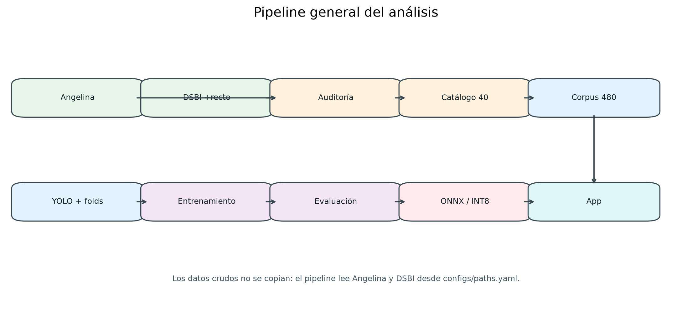

# Proyecto Braille — Reconocimiento óptico con CNN ligera

**Título:** Diseño y evaluación de una red neuronal convolucional ligera para el
reconocimiento óptico de Braille Grado 1 en dispositivos móviles: efecto en la
retroalimentación docente en aulas inclusivas de Moquegua e Ilo.

**Autores:** Rony Frank Churata Huania; Erick Jean Ramos Vera.

**Curso:** Trabajo de Investigación — Escuela Profesional de Ingeniería de
Sistemas e Informática, Universidad Nacional de Moquegua.



## Descripción

Repositorio del proyecto de investigación y del pipeline reproducible de análisis
de datos para el reconocimiento óptico de Braille Grado 1 con una CNN ligera
(YOLOv8n / YOLOv11, FP32 / INT8) orientada a dispositivos móviles.

Incluye:

- Documento del proyecto y artículo científico.
- Plantillas APA 7 para proyecto y artículo en LaTeX/Overleaf.
- Código de auditoría, preparación de datos, corpus derivado, folds,
  entrenamiento, evaluación y estadística.
- Informe de avance con diagramas, figuras y evidencias.
- Evidencias de auditoría y validación en JSON.

## Enlaces rápidos

| Documento | Enlace |
|---|---|
| Informe de avance | [`06_Codigo_Analisis/INFORME_AVANCE_2026-11-13.md`](06_Codigo_Analisis/INFORME_AVANCE_2026-11-13.md) |
| Plan de acción del corpus | [`06_Codigo_Analisis/PLAN_ACCION_CORPUS_DERIVADO.md`](06_Codigo_Analisis/PLAN_ACCION_CORPUS_DERIVADO.md) |
| README del código | [`06_Codigo_Analisis/README.md`](06_Codigo_Analisis/README.md) |
| Protocolo del corpus | [`06_Codigo_Analisis/docs/PROTOCOLO_CORPUS.md`](06_Codigo_Analisis/docs/PROTOCOLO_CORPUS.md) |
| Datos y auditoría | [`06_Codigo_Analisis/docs/DATOS.md`](06_Codigo_Analisis/docs/DATOS.md) |
| Plantillas APA 7 | [`05_Plantillas/README.md`](05_Plantillas/README.md) |
| Proyecto canónico | [`01_Proyecto_Tesis/Proyecto_OBR_Braille_APA7.docx`](01_Proyecto_Tesis/Proyecto_OBR_Braille_APA7.docx) |

## Estructura del repositorio

```text
.
├── 00_Administrativo/        Estado, guía e incidencias
├── 01_Proyecto_Tesis/        Documento del proyecto y fuente Overleaf
├── 02_Articulo_Cientifico/   Artículo científico y fuente Overleaf
├── 03_Evidencias/            Evidencia de fuentes de datos y avance
├── 05_Plantillas/            Plantillas APA 7 para proyecto y artículo
└── 06_Codigo_Analisis/       Pipeline de análisis, informe y figuras
```

## Estado del análisis

| Indicador | Resultado |
|---|---:|
| Corpus derivado | 480 imágenes (40 páginas × 12 condiciones) |
| Cajas anotadas | 141,444 |
| Clases cubiertas | 63/63 |
| Folds | 5 folds: 24 train / 4 val / 7 test + 5 externas |
| Pruebas | 13 aprobadas con `pytest` |
| Figuras del pipeline | 10 en `06_Codigo_Analisis/reports/figuras/` |

El corpus derivado se construyó con **Angelina** y **DSBI `+recto`**. Es un
corpus derivado, no un corpus de campo; requiere aprobación del asesor.

## Reproducir el análisis

```bash
cd 06_Codigo_Analisis
python -m pip install -r requirements.txt
```

Configura las rutas de los datasets en `configs/paths.yaml` y ejecuta:

```bash
python scripts/10_audit_sources.py
python scripts/11_build_page_catalog.py
python scripts/12_build_derived_480.py --overwrite
python scripts/13_validate_derived_480.py
python scripts/14_convert_yolo.py
python scripts/15_build_folds.py
python scripts/16_make_condition_grid.py
python scripts/17_make_pipeline_figures.py
python -m pytest -q
```

También puedes usar `make all` dentro de `06_Codigo_Analisis`.

## Datos

Los datasets crudos **no se incluyen** en el repositorio:

- **Angelina Braille Images Dataset:** https://github.com/IlyaOvodov/AngelinaDataset
- **DSBI:** https://github.com/yeluo1994/DSBI

Consulta `06_Codigo_Analisis/docs/DATOS.md` para tamaños, clases, exclusiones y
licencias. El corpus derivado y los pesos no se versionan; se regeneran con los
scripts.

## Entrenamiento y evaluación

```bash
cd 06_Codigo_Analisis
python -m src.training.train --config configs/yolov8n_fp32.yaml
python -m src.evaluation.evaluate --weights outputs/runs/yolov8n_fp32/weights/best.pt --data data/processed/yolo_derived/folds/fold_0/data.yaml
```

## Limitaciones

- El corpus es derivado, no de campo.
- Las fuentes son multilingües; el detector es agnóstico al idioma a nivel de
  celda, pero la evaluación no es “español”.
- Las 5 páginas manuscritas no garantizan errores ortográficos reales.
- La cuantización INT8 estática con calibración y el mapa español completo de
  acentos y signos quedan como `TODO`.
- Requiere aprobación del asesor antes del experimento final.

## Documentación adicional

- [`06_Codigo_Analisis/reports/estadistica/REPORTE_DATOS.md`](06_Codigo_Analisis/reports/estadistica/REPORTE_DATOS.md)
- [`06_Codigo_Analisis/reports/estadistica/REPORTE_DATOS.docx`](06_Codigo_Analisis/reports/estadistica/REPORTE_DATOS.docx)
- [`06_Codigo_Analisis/docs/METODOLOGIA.md`](06_Codigo_Analisis/docs/METODOLOGIA.md)
- [`06_Codigo_Analisis/docs/REPRODUCIBILIDAD.md`](06_Codigo_Analisis/docs/REPRODUCIBILIDAD.md)
- [`06_Codigo_Analisis/docs/APP.md`](06_Codigo_Analisis/docs/APP.md)
- [`06_Codigo_Analisis/src/deployment/android_contract.md`](06_Codigo_Analisis/src/deployment/android_contract.md)

---

*Repositorio académico del curso Trabajo de Investigación, UNAM.*
